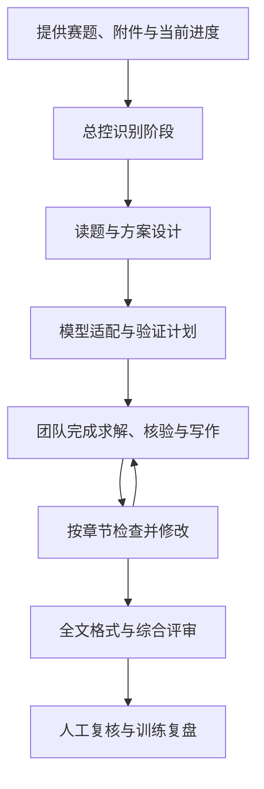

# HWB Math Modeling Skills

**面向研究生数学建模的 AI 工作流：把题目读清楚，把模型选明白，把论文改到有据可查。**

HWB Math Modeling Skills 围绕“华为杯”中国研究生数学建模竞赛的训练场景，将读题、方案设计、模型适配、章节检查和全文评审组织成可复用的 Agent Skills。你可以从一个具体问题开始，也可以通过总控入口安排已有材料的下一步处理。

项目由 [xieyouxixi](https://github.com/xieyouxixi) 维护，当前以 Skills、参考文档、文本索引和辅助脚本的形式交付，供 Codex、Claude Code 等支持相应 Skill 机制的环境使用。

> 本项目独立维护，与赛事组委会、华为及工具平台无官方隶属或背书关系。适合赛前训练、论文自查与赛后复盘；竞赛期间的使用范围须遵守当届规则。

[开始使用](#开始使用) · [查看能力](#能力目录) · [了解资料范围](#资料与来源) · [产品方向与合作](#产品方向与合作)

## 建模过程中，哪些环节值得交给它

一份论文的质量，取决于题意、数据、模型、计算结果和文字结论能否互相对应。这个项目把这些对应关系拆成具体的检查任务，帮助团队及时发现遗漏、比较方案，并安排修改顺序。

| 你现在遇到的情况 | 可以怎样使用 | 期望拿到的产物 |
| --- | --- | --- |
| 题干很长，附件和补充条件分散 | 逐句拆解任务、约束、数据口径与各问关系 | 可回溯的题意说明与任务清单 |
| 有几个模型想法，难以决定 | 比较候选方案，再核对数据与假设是否支持 | 选型依据、验证路线与备用方案 |
| 各章节写完了，整体逻辑仍不连贯 | 对照赛题检查问题分析、假设、符号与求解过程 | 定位到具体内容的问题与修改建议 |
| 终稿问题很多，不知道先改哪里 | 汇总专项检查，进行格式核对与综合评审 | 修改优先级及 HTML 评审报告 |
| 想用历史论文训练团队 | 借助赛题目录和论文索引安排阅读与复盘 | 按题型、年份和章节组织的训练线索 |

项目的工作方式有三个重点：

- **以当前材料为依据。** 题意解释回到原题，模型判断回到数据，论文评审回到正文与计算证据；缺少的材料需要明确列出。
- **按阶段调用。** 总控根据进度选择专项能力；写作过程中可以只检查一个章节，终稿阶段再集中处理全文问题。
- **让建议可以执行。** 检查结果应说明问题在哪里、依据是什么、需要补什么，以及先改哪一项。

## 开始使用

### 1. 准备运行环境与材料

你需要已配置可用的 Codex 或 Claude Code，并允许它读取本次任务所需的本地文件。项目本身不提供模型账号、API 额度或独立运行的网页应用。

首次使用建议选择一道历年赛题，准备完整题目、补充说明和附件。有论文初稿时，再加入论文、代码与结果文件。PDF、Word、扫描件的读取和版面检查依赖宿主环境提供的工具；无法读取的内容应先转为可检查的材料。

### 2. 获取并安装 Skills

可以在 GitHub 页面选择 **Code → Download ZIP**，也可以克隆：

```bash
git clone https://github.com/xieyouxixi/hwb-math-modeling-skills.git
```

将选用的 `hwb-...` 文件夹完整复制到目标目录，保留其中的 `SKILL.md`、`references/`、`assets/` 和 `scripts/` 等已有内容。

| 使用环境 | 当前项目使用 | 当前用户使用 |
| --- | --- | --- |
| Codex | `<工作项目>/.agents/skills/` | `~/.agents/skills/` |
| Claude Code | `<工作项目>/.claude/skills/` | `~/.claude/skills/` |

`~` 表示用户主目录。安装位置与加载方式可查阅 [OpenAI 官方 Skills 文档](https://developers.openai.com/codex/skills/)和 [Claude Code 官方 Skills 文档](https://code.claude.com/docs/en/skills)。

以 Codex 项目级安装为例，目录应类似：

```text
你的建模项目/
└── .agents/
    └── skills/
        ├── hwb-modeling-workflow/
        │   ├── SKILL.md
        │   └── references/
        ├── hwb-problem-translator/
        ├── hwb-modeling-ideas/
        ├── hwb-model-dictionary/
        └── 其他选用的 hwb-... 文件夹/
```

**复制具体 Skill 文件夹，不要把“生成类”“论文自查类”等外层分类目录整体作为一个 Skill 安装。** 使用完整工作流时，需要同时安装相应专项 Skills；总控入口本身不包含所有专项能力。

仓库有 **16 个不同名称的 Skill、19 个 Skill 目录**。`hwb-problem-restatement`、`hwb-ai-usage-disclosure` 和 `hwb-review-paper` 各有一份跨分类副本，安装时每个名称保留一份即可。首次完整安装可选择“总控类”“生成类”“综合评审与自我定位类”中的全部目录，再补充“论文自查类”中尚未安装的名称。

安装后打开或重新进入对应项目会话，确认工具能够找到 `hwb-modeling-workflow`。Claude Code 的评审补充配置见 [集成说明](integrations/claude-code/hwb-review-paper/CLAUDE.md)。

### 3. 发起第一个任务

在 Codex 中，可以从总控入口开始：

```text
调用 $hwb-modeling-workflow。

使用场景：历年真题训练
当前阶段：刚开始读题
赛题：<完整赛题路径>
补充说明与附件：<路径；没有则说明>

先梳理当前材料和任务要求，再安排读题与建模方案分析。
请列出阶段产物、待补材料和下一步行动。
```

在 Claude Code 中，使用 `/hwb-modeling-workflow`，并附上同样的任务信息。后文示例使用 Codex 的 `$Skill名称` 写法，在 Claude Code 中替换为对应的 `/Skill名称`。

## 从一次调用，到一轮完整迭代



总控用于安排任务和汇总结果，模型实现与计算需要在团队的求解环境中实际完成。评审意见也需要结合运行结果、专业知识与指导教师意见判断。

建议保留每轮论文版本、代码、结果与对应报告，先修正题意偏差、模型不成立和结果证据不足，再处理表达与排版问题。已有格式报告时，应提供与被评审论文相同版本的报告，减少重复检查。

## 能力目录

下表按使用任务归并展示，每个名称只列一次。具体输入要求、检查维度与输出规范以对应 `SKILL.md` 为准。

### 任务安排与方案设计

| Skill | 基本介绍 | 主要功能与交付 |
| --- | --- | --- |
| [`hwb-modeling-workflow`](skills/总控类/hwb-modeling-workflow/) | 完整流程的调度入口 | 识别阶段，选择专项 Skill，汇总产物与重复问题，安排下一步 |
| [`hwb-problem-translator`](skills/生成类/hwb-problem-translator/) | 赛题逐句解读工具 | 提取定义、约束、数据含义和交付要求，形成题意报告与跨问关系图 |
| [`hwb-modeling-ideas`](skills/生成类/hwb-modeling-ideas/) | 全题建模方案设计工具 | 梳理全文主线，比较各问候选模型，给出选型理由、验证路线与风险 |
| [`hwb-model-dictionary`](skills/论文自查类/hwb-model-dictionary/) | 候选模型的适配顾问 | 结合题目、数据和用途检查假设、适用条件、失效情形与替代方法 |
| [`hwb-problem-restatement`](skills/生成类/hwb-problem-restatement/) | 问题重述的起草与核对工具 | 生成章节草稿，或对照原题检查任务遗漏、条件失真和章节越界 |

### 论文内容与表达检查

| Skill | 基本介绍 | 主要功能与交付 |
| --- | --- | --- |
| [`hwb-abstract-checker`](skills/论文自查类/hwb-abstract-checker/) | 题目、摘要与关键词检查工具 | 核对任务、方法、结果和结论是否完整对应，给出修改重点 |
| [`hwb-problem-analysis-checker`](skills/论文自查类/hwb-problem-analysis-checker/) | 问题分析章节检查工具 | 检查任务映射、数据推理、模型选择依据与各问衔接 |
| [`hwb-model-assumption-checker`](skills/论文自查类/hwb-model-assumption-checker/) | 模型假设审查工具 | 诊断假设是否必要、合理且与题意一致，提示缺失条件和验证要求 |
| [`hwb-symbol-notation-checker`](skills/论文自查类/hwb-symbol-notation-checker/) | 全文符号一致性检查工具 | 排查符号遗漏、定义冲突、单位与上下标问题 |
| [`hwb-model-solution-checker`](skills/论文自查类/hwb-model-solution-checker/) | 模型建立与求解检查工具 | 核对推导、算法、结果、检验及灵敏度分析，定位证据和复现缺口 |
| [`hwb-reference-appendix-checker`](skills/论文自查类/hwb-reference-appendix-checker/) | 引用与支撑材料检查工具 | 检查正文引用、文献表、附录、程序和复现材料之间的对应关系 |
| [`hwb-ai-usage-disclosure`](skills/生成类/hwb-ai-usage-disclosure/) | AI 使用记录与披露工具 | 根据真实记录起草声明与详情，检查披露和论文内容的一致性 |

### 全文审查与训练定位

| Skill | 基本介绍 | 主要功能与交付 |
| --- | --- | --- |
| [`hwb-paper-aigc-auditor`](skills/论文自查类/hwb-paper-aigc-auditor/) | 模板化表达与建模真实性审查工具 | 标记空泛论述、模型拼装和伪改进，提供基于证据的修改建议 |
| [`hwb-paper-format-checker`](skills/论文自查类/hwb-paper-format-checker/) | 全文格式与文件检查工具 | 核对页面结构、匿名性、图表公式、排版和文件卫生，输出检查结果 |
| [`hwb-review-paper`](skills/综合评审与自我定位类/hwb-review-paper/) | 基于具体赛题的综合评审工具 | 制定任务评分细则，逐项评审，给出质量分析与参考定位，生成 HTML 报告 |
| [`hwb-cpgmcm-award-standing`](skills/综合评审与自我定位类/hwb-cpgmcm-award-standing/) | 历史竞争格局与训练定位工具 | 结合输入规模、名次或自评分，提供区间估计与备赛建议 |

AIGC 审查提供的是内容特征与证据分析，不能证明某段文字由谁生成，也不能替代查重或作者责任判断。评分、百分位和奖项区间属于辅助估计，不构成官方评价或获奖承诺。

## 三个常用任务示例

### 有方案，先确认模型能否落地

```text
调用 $hwb-model-dictionary。

赛题：<完整赛题路径>
数据结构：<样本量、变量、缺失情况、时空结构等>
候选模型：<模型名称>
计划用途：<对应哪一问、要回答什么>
现有条件：<时间、工具与计算资源>

请逐项判断适配性，说明需要验证的假设、失败风险和备选方法。
```

### 有初稿，安排一轮修改

```text
调用 $hwb-modeling-workflow。

使用场景：模拟训练论文自查
赛题与附件：<路径>
当前论文：<路径与版本>
代码及结果：<路径；尚未完成的部分请明确说明>
已有检查报告：<路径；没有则说明>

请选择当前最需要的专项检查，合并重复问题，按影响排序给出修改清单。
缺少证据的结论请标为待核实。
```

### 有终稿，获取综合评审报告

```text
调用 $hwb-review-paper。

年份与题号：<年份、题号>
完整赛题：<路径>
完整论文：<路径与版本>
附件、代码与结果：<可提供的路径>
同版本格式检查报告：<可选路径>
参赛规模或历史参照：<可选，注明来源；不清楚则说明>

请根据本题制定评分细则，并生成 HTML 评审报告。
区分论文质量判断与竞争环境估计，标注无法确认的事项。
```

## 资料与来源

仓库中的参考材料用于支持读题、检查与训练复盘。目前的[赛题索引](数模资料/历年赛题库/赛题库总览.csv)覆盖 2020—2025 年的 36 道题，[优秀论文索引](数模资料/优秀论文索引/优秀论文索引.csv)包含 229 条论文记录。

**这些数字表示索引覆盖范围。仓库不包含对应赛题、论文、数据集的原始文件，也不附带这些材料的商业传播授权。** 如需阅读或计算，请自行从官方或其他合法授权渠道获取原始材料。

| 资料入口 | 内容与用途 |
| --- | --- |
| [数模资料总览](数模资料/README.md) | 目录说明、资料范围及使用约定 |
| [赛事规则整理](数模资料/官方文件/) | 赛事事实基准与规则整理；涉及当届要求时须核对官方文件 |
| [历年赛题目录](数模资料/历年赛题库/) | 题目名称、年份、题号与题型线索 |
| [优秀论文阅读资料](数模资料/优秀论文索引/) | 论文索引与分阶段阅读指南 |
| [章节写作说明](数模资料/各板块详细说明文档/) | 章节任务、写作关注点与自查入口 |
| [评阅资料说明](数模资料/官方评阅细则/) | 评审流程与关注点整理，使用时需区分官方文件和项目归纳 |
| [模板获取说明](数模资料/论文模板/) | 官方模板获取路径与使用要点 |
| [数据集说明](数模资料/数据集说明/) | 已整理数据集的结构与字段说明 |

资料中出现的 `<本地归档根目录>` 是路径占位符，使用前需替换为你自己的实际目录。历史规则和经验不能自动视为当届规则，最新要求请查阅[赛事官方平台](https://cpipc.acge.org.cn)。

## 项目结构

```text
hwb-math-modeling-skills/
├── README.md
├── CHANGELOG.md
├── skills/
│   ├── 总控类/                 # 阶段识别与任务安排
│   ├── 生成类/                 # 读题、方案与章节草稿
│   ├── 论文自查类/             # 内容、格式与证据检查
│   └── 综合评审与自我定位类/   # 全文评审与训练定位
├── integrations/claude-code/   # Claude Code 补充配置
└── 数模资料/                   # 参考文档与文本索引
```

部分 Skill 附带 Python 辅助脚本。运行这些脚本需要可用的 Python 环境；具体参数、数据依赖与用途请查看对应目录。仅安装 Skill 不代表求解环境或文档处理工具已配置完成。

## 产品方向与合作

项目计划围绕**研赛训练与论文质量改进**持续发展，将当前的工作流、检查规则与评审报告进一步整理为便于个人、团队和教学场景使用的产品能力。

当前交付范围以本仓库实际文件为准。后续拟探索的方向包括：

- 配套教学案例与训练任务，帮助用户理解每次检查背后的建模方法。
- 更便捷的安装、材料整理和版本管理，减少团队使用成本。
- 更清晰的评审报告与修改跟踪，支持多轮训练和复盘。
- 面向教学团队的工作流配置、使用培训与定制集成。

以上为发展方向，尚不代表已上线的付费版本、服务套餐或交付承诺。未来若提供商业产品或服务，将另行公布适用范围、交付内容、价格、支持方式与授权条款。

功能建议与合作意向可通过 [GitHub Issues](https://github.com/xieyouxixi/hwb-math-modeling-skills/issues)提出，或关注[维护者主页](https://github.com/xieyouxixi)后续公布的联系渠道。公开讨论中请勿附上未公开论文、个人身份信息或其他敏感材料。

## 授权与使用边界

**本仓库当前尚未提供统一的 LICENSE 文件。** 商业集成、付费分发、再授权等需求，请先与维护者明确涉及的内容和使用范围，并以正式授权文件为准。本 README 的产品规划不构成商业授权。

第三方赛题、论文、数据集、模板和工具各有其来源与适用条款，项目的索引和说明不替代对应授权。后续发布商业版本时，还需逐项确认所包含材料的来源、许可与署名要求。

使用本项目时，请保留以下基本原则：

- 按当届竞赛文件确认 AI 使用、材料保密、论文格式与提交要求；真实记录并披露 AI 的辅助用途。
- 模型选择、代码运行与结论核验由使用者负责，不虚构实验、数据、引用或计算结果。
- 项目定位于训练、自查与复盘，不提供赛题代做、论文代写、检测规避或获奖保证。

## 反馈与维护

反馈时建议说明使用环境、调用的 Skill、材料类型、期望行为与实际表现，并提供经过脱敏的最小示例。涉及赛事规则时，请同时给出文件年份和官方来源，便于核实与更新。

版本记录见 [CHANGELOG.md](CHANGELOG.md)。
